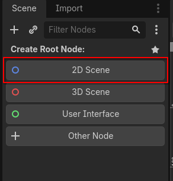
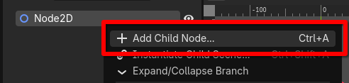
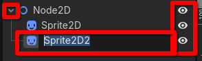
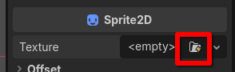
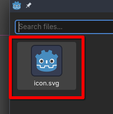
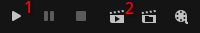
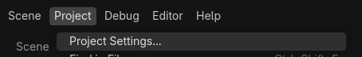
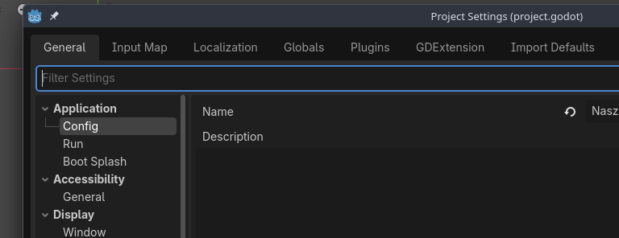
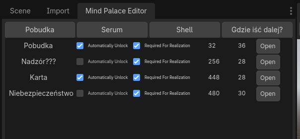

# Kurs Godota
### Wstęp do Edytora
#### Stworzenie nowego projektu
Cały Godot zawiera się w jednym pliku wykonywalnym  
Odpalenie tego pliku otwiera Menadżera Projektów – jak odpalimy w nim projekt dopiero wtedy odpali się pełny Godot.  
Ustawiamy Compatibility przy tworzeniu nowego projektu, aby odpalił się na starych kartach graficznych tj. Stare Integry Intela (HD 3000)  

### UI Godota - Dock
UI Godota składa się z panelu głównego oraz tabów, które nazywają się „Dock”. Można je przemieszczać pomiędzy dostępnymi pozycjami i do oddzielnego okna. Dostępne pozycje mogą się rożnić w zależności od docka. Przykładem jest dock Output i Debugger, który ma dostępne pozycje tylko na dole.

Dock’a możemy przenieść intuicyjnie myszką. 
Mozemy również go przenieść w alternatywny sposób jak poniżej. Prawym przyciskiem na nazwie Docka otwieramy menu. Biały kolor oznacza aktualną pozycję. Bardziej szare opcje oznaczają miejsca gdzie już znajdują się inne dock’i

Dla niektórych dock’ów są dostępne tylko niektóre pozycje, które są oznaczone przez szare opcje

### UI Godota - Głowny Panel
Po środku jest główny panel który rządzi się innymi zasadami – go się przełącza przyciskami na samej górze i nie mają opcji personalizacji.  
Od przyszłej wersji Godot 4.8 (która teraz jest w becie), taby w głównym panelu, dostaną opcje personalizacji tj. ukrycie tab’u i floating window.

### Node
Aby wyjaśnić okno Scene, trzeba najpierw znać koncept Node’a  
Node to w skrócie jest Instancja skryptu, który dziedziczy po godotowym skrypcie „Node”. Dzięki temu dziedziczeniu każdy node ma swoją nazwę, może posiadać swoich dzieci i rodziców oraz może wywoływać callback’i godota.
#### Terminy z OOP
Instancja - w skrócie oznacza konkretny zestaw danych (tj. konkretny obiekt fizyki) na których dany skrypt oddziałuje (Dane są połączone z funkcjami w danym skrypcie)  
Dziedziczenie – służy do rozszerzenie funkcjonalności skryptu poprzez dodanie do niego nowej funkcjonalności i zmiany zachowania skryptu dziedziczonego. Przykład z Godota – Node3D dziedziczy po Nodzie – wtedy Node3D zawiera funkcjonaność Node’a, ale też dodatkowa posiada koordynaty w trzech wymiarach.  

#### Utworzenie pierwszego Node'a

 Teraz aby utworzyć pierwszego Node. Trzeba nacisnąć na 2D Scene w oknie Scene. Utworzy się wtedy Node o typie Node2D  
  

 Node’y tworzą razem drzewo. Node, który właśnie utworzyliśmy jest zwany node’m głównym – „Root”, który jest na samym szczycie, i występuje on tylko jeden. Pod nim znajdują się jego childreny, a pod nimi znajdują się ich childreny – i tak dalej…
W Hierarchy możemy edytować to drzewo. Dodawać childreny, przenosić childreny z jednego node’a do drugiego itd.


Child’a można dodać poprzez naciśnięcie prawym przyciskiem na node’a i nacisnięcie tego przycisku. Wtedy otworzy ci się okno gdzie możesz wyszukać typ o jakim ma być ten nowy Node. W ramach kursu utwórz dwa razy node’y o typie Sprite2D.  



Childreny danego node’a można zwinąć strzałką po jego lewej stronie w UI „Scene” tak aby nie trzeba było ich widzieć
Po prawej stronie znajduje się też Oko, którego naciśnięcie przełącza widoczność Node’a 
UWAGA: wyłączenie widocznośći NIE WYŁĄCZA zachowania node’a – On ciągle występuje w scenie i odpala swój skrypt
Również klikając dwukrotnie na node’a, lub naciskając F2, można zmienić jego nazwę  


### Zmienne w Godocie
Zmienne w Nodzie (czyli instancji skryptu) można modyfikować w oknie Inspector po jego zaznaczeniu w oknie Scene. 
Będą tam wyświetlone wszytskie klasy, po których dziedziczy skrypt Node’a. Do każdej klasy będą wylistowane wszytskie ich dostępne zmienne do modifikacji i/lub odczytu.
Nie wszystkie zmienne klasy są pokazywane przez godota. W własnych skryptach pokazuje się pożądane zmienne poprzez adnotację @export w skrypcie (o czym mowa później)

Teraz w obydwóch utworzonych Node’ach Sprite2D ustaw zmienną texture poprzez mały przycisk folderu i ustaw icon.svg  
  

### Koncept Sceny
Wcześniej omawiane drzewo node’ów nazywamy sceną i możemy zapisać je do pliku. Wtedy będzie zapisany każdy typ node’a, układ drzewa nede’ów oraz wartości zmiennych.

### Tworzenie własnej sceny
W ramach kursu zapisz scenę poprzez Ctrl+S i nazwij go main_scene.tscn  

Możemy również utworzyć taką scenę samemu poprzez naciśnięcie prawego przycisku myszki w folderzie i wybranie „New Scene” lub Create New → Scene. Wtedy pojawi nam się wybór podobny do tego co mieliśmy na początku w hierarchy i działa on tak samo.

### Odpalanie Sceny
Są dwa taby w głównym panelu które nas obchodzą: 2D i Game.
W 2D widzimy edytowaną aktualnie scenę
W Game widzimy odpaloną grę
Grę można odpalić klikając w przyciski poniżej  
  
1 – odpalenie głównej sceny,  2 – odpalenie aktualnie edytowanej sceny

### Poruszanie się po scenie
Poruszać się po scenie w panelu 2D można poprzez nacisnięcie środkowego przycisku myszki oraz przesunięciem myszki
Można również nasinąć G i po prostu przesunąć naśniętą myszkę. 
Na górze można zobaczyć inne tryby edycji – Q jest defaultowym trybem, G jest właśnie jednym z tym trybów i W/E/R – oznaczają w kolejności tryby translacji/rotacji/skalowania

Teraz poprzez bardziej preferowany ci sposób (Tryb Q lub W) zmień pozycję jednego z Node’ów i zapisz scenę.
Możesz odpalić scenę, aby zobaczyć że zmiany widać w panelu „Game”

### GDScript
Godot do skryptów używa własnego oryginalnego języka – GDScript. Jest on podobny składniowo do Pythona, lecz jest bardziej elastyczny oraz głęboko połączony z silinkiem – co poprawia komfort z pisania.
Przejdź do panelu „Scripts” i w lewym górnym rogu panelu naciśnij File → New Script, aby utworzyć nowy skrypt. Nazwij go rotate.gd

### _process i _ready
Ponieważ każdy Node w scenie musi dziedziczyć po godotowym skrypcie „Node”, to w każdym skrypcie są dostępne funkcje, które Godot wywołuje za nas. Jedną z takich funkcji jest _process i _ready. 
_ ready wywołuje się gdy node wraz z wszystkimi jego childrenami się załaduje
_process wywołuje się co każdą klatkę gry

W funkcji _process dopisz:
rotate(delta)
delta jest zmienną float od godota, która mówi ile czasu minęło na wyświetlenie poprzedniej klatki. Umożliwia on dopasowanie szybkości działania skryptu do ilości FPS(Frames Per Second) różnych komputerów. Im więcej FPS, tym mniejsza wartość delta, więc wtedy funkcja _process odpali się częsciej i tym samym różnice się wyrównają

### Zmienne i @export
Zmienne w skrypcie tworzymy poprzez format
```
var nazwa_zmiennej : typ zmiennej 
```
Dodaj nad funkcjami linijkę 
```
var speed : float = 5.0
```
równoważne jest również ```var speed := 5.0```, ponieważ typ zmiennej się „obliczy” na podstawie przypisanej wartości czyli 5.0  
Dodaj również  * speed do linijki w _process. Linijka tak będzie wyglądała po edycji:
```
    rotate(speed * delta)
```
Godot pozwala na zmienne bez typów, ale wtedy ma gorszą wydajność
Jeśli chcemy by w oknie „Inspector” pokazała się zmienna z naszego skryptu, musimy dodać adnotację @export przed zadeklarowaniem tej zmiennej.  
Dlatego musimy dodać tą adnotację do wcześniej zadeklarowanej zmiennej:
```
@export var speed := 5.0
```

### print() i Konsola
Możemy również wyświetlić rzeczy poprzez funkcję print(), pojawi się wtedy ona w Oknie „Console” na dole.
Dostępna jest również funkcja printerr() dla wyświetlenia erroru.  
Dodaj w skrypcie do _process linijkę:
```
    print(„obracam się yippiee”)
```

### Nasz pierwszy skrypt
Teraz możemy podłączyć nasz pierwszy skrypt
Zaznacz node’a Sprite2D i w oknie Inspectora na dole będziesz miał puste pole Script
Przeciągnij tam skrypt o nazwie rotate.gd z okna FileSystem
Zapisz i Odpal scenę
Ujrzysz teraz że w scenie jeden sprite się obraca, a w konsoli ukazuje się tekst
Możesz teraz w oknie Inspector zmienić wartość speed i ujrzyć że większą/mniejsza wartość szybciej/wolniej obraca gracza

## W domu

### Załadowywanie projektów
Projekty godota to są zwykłe foldery z plikiem project.godot i ukrytym folderem .godot w środku
Aby załadować pobrany projekt, trzeba nacisnąć import w Menadżerze Projektów Godota i wejść do folderu projektu. Wtedy plik project.godot powinnien być automatycznie wybrany i trzeba jedynie nacisnąć Open i potem Import

### Nasz projekt
### Sygnały
### Local i Remote Scene
Podczas odpalenia sceny widać dwie zakładki w oknie Scene: Remote oraz Local.
Local oznacza scenę, którą edytowaliśmy w Godocie
Remote oznacza instancję sceny odpaloną w panelu Game
Te dwie sceny są oddzielne od siebie. Remote jest tworzone po odpaleniu i usuwane po zakończeniu gry
Można używać zakładki Remote do szybkiego testowania różnych wartości oraz sprawdzania zmiennych

Zakładkę remote można też uzyskać gdy odpali się debugową wersje builda gry i połączy się go z edytorem.

### Sceny i „Prefaby”
Jako prefab rozumiemy obiekt który jest zapisany do pliku i można kopiować we scenie.
Słuzy to temu aby mieć jeden plik, który jest oryginalny i nowe edycje w nim zaaplikowały się do wszystkich jego instancji
Inne siliniki odróżniają sceny od prefabów
W Godocie prefab jest sceną, więc nie ma odróżnienia pomiędzy prefab’em a sceną.
Dlatego że scena jest to drzewo node’ów, jest ona bardziej elastyczna. Każdą scenę da się zinstancjować w innej scenie.

### Project Settings
  
Znajdują się tam ustawienia projektu.  
  
Tam się ustawia np. defaultowy tryb okna w jakim ma się odpalic gra, ustawienia renderera, fizyki itd.
 Uwzględniają one też lokalizację tekstu, Input Map’y. Globals (Globalne Node’y), Pluginy i GDExtension

### Pluginy i GDExtension
Poprzez pluginy można rozszerzyć funkcjonalność edytora Godota. Przykład będzie na następnym slajdzie.
GDExtension służy do pisania kodu który komunikuje się z natywną warstwą silnika.
Słuzy on do rozszerzenia funkcjonalności samego silnika Godota. Przykładem jest plugin Terrain3D
Społeczność może tworzyć własne bindingi do niego, dlatego może używac wiele języków tj. C++, Rust, Python, Odin.
Istnieje również system modułów C++, które są bardziej zintegrowane z silnikiem Godota nie mogą być pisane w innym języku

### Własne Tools’y
Edytor Godota sam w sobie jest „grą” w silniku Godota. Jego UI jest drzewem node’ów. 
Poprzez plugin możemy po prostu sami dodawać do edytora node’y służące do UI i wtedy będziemy mogli je ujrzeć.
Przykład stworzonego tool’a do szybkiej edycji danych w poprzednim projekcie:  


### Best Practices


